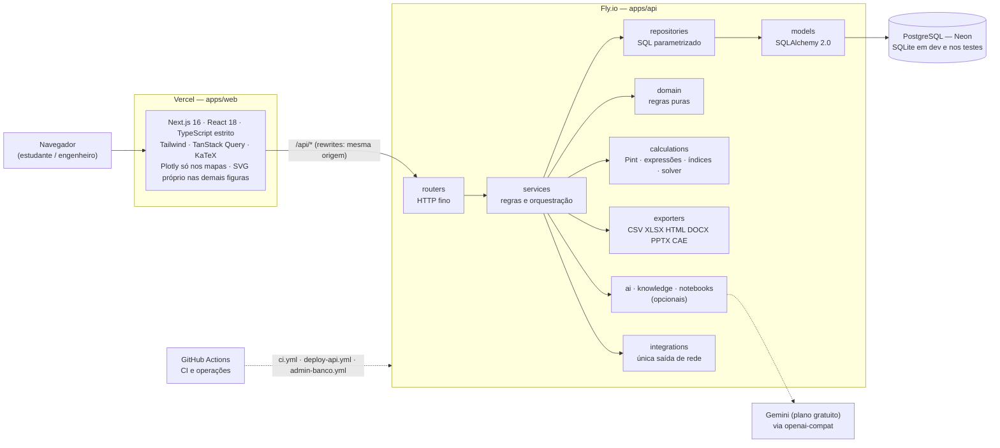

# Guia para escrever a monografia do TCC

**Para quem é.** Para a pessoa (ou o assistente) que escreve a monografia de
Engenharia de Materiais sobre o MaterialSelect AI e precisa, num só lugar,
entender o que o app é, como ele funciona, o que está pronto, o que é
demonstrativo e onde conferir cada afirmação. Escrito em 02/11/2026 sobre o
commit `e617033` de `main` (depois do PR #219) — [D-194](DECISIONS.md).

**Como usar.** Leia as seções 1 a 3 inteiras. Das seções 4 a 6, leia a parte que o
capítulo em escrita pede (a seção 10 diz qual). Cada fato traz o arquivo ou a
decisão `D-NN` que o sustenta; o que não deu para confirmar no repositório está
marcado **a confirmar**. Quando um número aqui divergir de outro documento, vale
o medido: a contagem de testes vive em [`PROJECT_CONTEXT.md`](PROJECT_CONTEXT.md)
§3, o resto na seção 5 daqui.

> **Aviso que vale para a monografia inteira.** O catálogo que está no ar é
> **demonstrativo** (seção 6): valores fictícios ou estimados, marcados no banco
> (`is_demo`), mas **sem aviso na tela nem nos arquivos exportados**
> ([D-138](DECISIONS.md)). Qualquer figura ou tabela de material retirada do app
> para a monografia precisa dizer isso por escrito.

---

## 1. O que é o app

**MaterialSelect AI** é uma plataforma web para **ensinar e praticar a seleção de
materiais de engenharia pelo método de Michael Ashby**: mapas de propriedades,
índices de desempenho e seleção em etapas ([`README.md`](../README.md);
[`PROJECT_CONTEXT.md`](PROJECT_CONTEXT.md) §1). É o TCC de Francisco de Almeida
Lemos (Engenharia de Materiais, UFRGS, semestre 2026/2), com orientação do Prof.
Felipe A. L. Sánchez (`PROJECT_CONTEXT.md` §1).

**O problema.** Seleção de materiais concilia várias propriedades (mecânicas,
térmicas, econômicas, ambientais) sob restrições de projeto. As ferramentas
consagradas são proprietárias ([`01-visao-geral.md`](01-visao-geral.md)). A
proposta do TCC aponta três dores concretas (`PROJECT_CONTEXT.md` §2):

1. **Bases heterogêneas**: planilhas com unidades inconsistentes, intervalos,
   vírgula decimal e lacunas não sinalizadas.
2. **Opacidade**: a ferramenta comercial entrega o resultado sem mostrar quais
   conversões, hipóteses e critérios o produziram.
3. **IA para tarefa numérica**: risco de valor inventado e de recomendação que
   ninguém consegue reproduzir.

**A contribuição não é um catálogo de materiais.** É tornar o método de Ashby
**reprodutível, auditável e extensível** (`PROJECT_CONTEXT.md` §2; `README.md`).
Todo número na tela ou num arquivo exportado sai de um cálculo determinístico no
servidor, com a trilha de onde veio. A IA interpreta, sugere e explica, e nunca
produz um número.

**Para quem.** Estudantes de graduação em Engenharia de Materiais e engenheiros em
triagem inicial. O texto da proposta fala em apoio didático; a interface é toda em
português do Brasil ([`CLAUDE.md`](../CLAUDE.md), "Idiomas";
[D-191](DECISIONS.md) nomeia "estudante e engenheiro" como público). O teste de
usabilidade com estudantes está **instrumentado mas não foi aplicado**
([`11-usabilidade.md`](11-usabilidade.md); seção 6).

**Onde está.** Frontend em <https://material-select-ai-web.vercel.app>, com login
pelo Google (`README.md`). A ferramenta fica atrás de um portão de assinatura,
que o autor abre para uma turma pelo "modo de acesso" ([D-46](DECISIONS.md),
[D-83](DECISIONS.md)).

---

## 2. O método

### 2.1 Ashby no app

A metodologia está explicada em [`04-metodologia-selecao.md`](04-metodologia-selecao.md)
e o motor em [`07-selecao-deterministica.md`](07-selecao-deterministica.md). Em
resumo:

| Conceito de Ashby | Como o app o realiza | Onde |
|---|---|---|
| **Mapa de propriedades** (par de propriedades, escala log, envelope por classe) | Mapa em `/app/mapas`; envelope de classe é uma nuvem **indicativa**; um eixo pode ser um índice | [`08-visualizacao.md`](08-visualizacao.md); [D-40](DECISIONS.md), [D-54](DECISIONS.md) |
| **Índice de desempenho** `M` (função, objetivo e restrição viram uma expressão, ex.: `E/ρ`, `E^(1/2)/ρ`, `E^(1/3)/ρ`) | Catálogo de índices com as hipóteses visíveis **antes** da escolha, mais expressões montadas na calculadora | [D-25](DECISIONS.md), [D-191](DECISIONS.md) |
| **Linha de índice** (reta no mapa log-log) | A inclinação é **derivada** da expressão (`−a/b` para `M = C·X^a·Y^b`) pelo backend, e quando a expressão não é lei de potência o app diz que não há reta | [`04`](04-metodologia-selecao.md) "Da expressão à reta"; `calculations/powerlaw.py`; [ADR 0004](adr/0004-geometria-de-graficos-no-backend.md) |
| **Seleção em estágios** (limites, árvore de classes, processo, região de gráfico) | Uma **pilha ordenada de estágios**; o resultado é a interseção dos habilitados | [D-56](DECISIONS.md) a [D-60](DECISIONS.md) |
| **Função → Restrições → Objetivo → Resultados** | O motor filtra e depois ordena; a tela pede o Objetivo antes das Restrições, sem mudar o cálculo | [D-88](DECISIONS.md) |
| **Ranking multicritério** | Soma ponderada, TOPSIS, PROMETHEE II e pesos por AHP (recusa matriz com razão de consistência acima de 0,1), análise de sensibilidade | [`04`](04-metodologia-selecao.md); [D-87](DECISIONS.md) |
| **Dado ausente** | O material sem o dado **sai do ranking e é listado como excluído**; nunca recebe zero nem a média | [D-07](DECISIONS.md) |

**Estudo de caso de validação.** O tirante leve e rígido (índice `E/ρ`), do
enunciado ao laudo, executado contra a aplicação real com nove materiais de
literatura (cifras representativas de classe, não medição de lote). O resultado
bate com os três pontos da literatura: compósitos à frente de metais, os três
metais estruturais num platô de menos de 2% entre si, cerâmica excluída por
fragilidade apesar do melhor índice bruto. Roteiro em
[`12-estudo-de-caso.md`](12-estudo-de-caso.md), evidências em
[`estudo-de-caso/`](estudo-de-caso/), regressão automatizada em
`test_case_study.py`. As cifras vêm de resumos de busca, não de tabela lida por
inteiro ([`estudo-de-caso/README.md`](estudo-de-caso/README.md)).

### 2.2 Os princípios que não se negociam

Estão em [`CLAUDE.md`](../CLAUDE.md) (versão curta) e em
[`docs/CLAUDE.md`](CLAUDE.md) §1 (versão completa, com o motivo de cada um). São a
base da alegação de reprodutibilidade, e a monografia pode apresentá-los como a
tese metodológica.

| # | Princípio | O que significa na prática | Decisões |
|---|---|---|---|
| 1 | **Não inventar propriedades** | Só existe valor cadastrado ou importado, com fonte. Nada estimado entra sem marca | [D-21](DECISIONS.md) (campo opcional continua `NULL`) |
| 2 | **Todo cálculo é determinístico e vive no backend** | Inclusive o que parece apresentação: inclinação de linha de índice, envelope, escore normalizado, treemap, histograma. O React só desenha | [ADR 0004](adr/0004-geometria-de-graficos-no-backend.md) |
| 3 | **A IA nunca gera número** | Toda saída passa por guardrails: a entidade tem de existir no catálogo, **todo número tem de aparecer no enunciado** (ou no trecho citado), a unidade tem de ser compatível e declarada | [ADR 0003](adr/0003-ia-desacoplada-do-calculo.md), [D-08](DECISIONS.md), [D-09](DECISIONS.md), [D-35](DECISIONS.md), [D-47](DECISIONS.md) |
| 4 | **Dado ausente nunca vira zero** | `is_missing=True` com campos numéricos `NULL` (regra em `app/domain/data_quality.py`); na tela, a ausência tem rótulo escrito; em gráfico, é vão ou quebra de linha | [D-07](DECISIONS.md), [D-24](DECISIONS.md) |
| 5 | **Rastreabilidade de unidades** | Cada valor guarda original + unidade original + normalizado + unidade canônica + método de conversão; a conversão só passa por `app/calculations/units.py` (Pint) | [ADR 0002](adr/0002-pint-para-unidades.md), [D-70](DECISIONS.md) |
| 6 | **Sem segredos versionados** | Configuração por variável de ambiente; há `.env.example` | — |
| 7 | **Dados de demonstração são marcados** (`is_demo`) | O marcador é dado no banco, não texto na tela; criar ou apagar demo segue [`15-dados-demonstrativos.md`](15-dados-demonstrativos.md) | [D-71](DECISIONS.md), [D-72](DECISIONS.md), [D-138](DECISIONS.md) |
| 8 | **Catálogo só de fonte aprovada** | Fonte aberta só entra com veredito APROVADA em [`catalogo/fontes.md`](catalogo/fontes.md) e pelo pipeline do catálogo oficial; MatWeb, Total Materia, ASM, MMPDS e CAMPUS ficam **recusadas** para extração em massa | [D-102](DECISIONS.md), [D-103](DECISIONS.md) |

Regras de apoio que a monografia pode citar: parser de expressões **sem `eval`**
([D-05](DECISIONS.md)), dimensão do índice **derivada**, não declarada
([D-06](DECISIONS.md)), exportação que **neutraliza fórmula** de planilha e
marcação de HTML ([D-13](DECISIONS.md)), exportador que **reexecuta o pipeline**
em vez de guardar resultado ([D-14](DECISIONS.md)), qualidade do dado em três
canais, nunca só cor ([D-24](DECISIONS.md)).

### 2.3 Níveis de profundidade L1, L2 e L3

Inspirados na organização em três níveis do Granta EduPack (lacuna #25 do
relatório de comparação, [D-127](DECISIONS.md)). O nível é **só visão**: controla
quantas propriedades a ficha e os seletores mostram (`?nivel=1|2`; o 3, que mostra
tudo, é o padrão). **Nunca entra no cálculo**: um teste (canário) roda a mesma
seleção com e sem o nível e exige resposta idêntica. A ficha escreve "O Nível N
mostra X de Y propriedades" e diz que as demais não estão ausentes. Cada
propriedade declara o nível mínimo em `PROPERTY_MIN_LEVEL`
(`app/domain/depth_profile.py`). O nível chegou também aos estágios, ao comparador
e ao Find Similar ([D-165](DECISIONS.md)) e ao filtro do Painel
([D-193](DECISIONS.md)). O catálogo oficial deveria trazer os níveis reais
(pendência PD-c do [`TODO.md`](TODO.md)); hoje valem os do código.

---

## 3. A arquitetura

Monorepo com backend e frontend desacoplados e um contrato de tipos único
([`ARCHITECTURE.md`](ARCHITECTURE.md); [`README.md`](../README.md), "Arquitetura").



**Camadas do backend.** `routers` → `services` → `repositories` → `models`, com
regras puras em `domain` e cálculo determinístico em `calculations`. Router não
tem regra de negócio; só o repositório fala com o banco; `integrations` é a única
porta de saída para a rede (`safe_fetch.py`). Contratos em Pydantic v2
(`schemas`). Detalhe e tabela de responsabilidades em
[`ARCHITECTURE.md`](ARCHITECTURE.md) §3.

**Camada de IA, desacoplada.** O provedor recebe só o catálogo e o texto, nunca uma
sessão de banco nem o avaliador de expressões. Quatro provedores atendem o mesmo
contrato: `mock` (padrão do código e dos testes: determinístico, sem rede),
`claude-api`, `claude-cli` e `openai-compat`. A IA oficial é o **Gemini no plano
gratuito**, por `openai-compat`, com a chave de um projeto sem faturamento (passar
do limite dá erro 429, nunca cobra; [D-93](DECISIONS.md)). O provedor escolhe um
índice **por slug**; a expressão e as ressalvas vêm do backend
([D-35](DECISIONS.md)). Detalhe em [`09-camada-ia.md`](09-camada-ia.md).

**Dados.** PostgreSQL no Neon em produção; SQLite em desenvolvimento e nos testes
([ADR 0001](adr/0001-sqlite-agora-postgres-depois.md)). O schema é do Alembic (42
migrations); o modelo de dados está em [`03-modelo-de-dados.md`](03-modelo-de-dados.md)
e o diagrama ER em [`ARCHITECTURE.md`](ARCHITECTURE.md) §5. O coração é
`material_property_value`, com toda a proveniência e unicidade por par
material × propriedade.

**Publicação.** Frontend na Vercel (publica a cada push em `main`), API no Fly.io
(a `release_command` aplica as migrações antes do tráfego), banco no Neon. A API é
servida **pela origem do frontend** (`rewrites()` no `next.config.mjs`), porque o
cookie de sessão `SameSite=Lax` não viajaria entre domínios ([D-52](DECISIONS.md)).
Mesclar um PR **não** implanta a API nem semeia o banco: são workflows de disparo
manual (`deploy-api.yml`, `admin-banco.yml`, `provedor-ia.yml`, `modo-acesso.yml`,
`conhecimento.yml`; [`13-deploy.md`](13-deploy.md)).

**Autenticação.** Login só por terceiros (Google, OAuth 2.0), sem senha em lugar
nenhum; a sessão é uma linha de banco, não um JWT, para o logout revogar de
verdade ([D-42](DECISIONS.md)). O catálogo é compartilhado; o estudo de seleção é
privado ao projeto do usuário. A auditoria registra quem mudou o quê, com retrato
do e-mail e do rótulo ([D-43](DECISIONS.md)).

**Integração contínua.** `.github/workflows/ci.yml` roda em todo PR e push para
`main`: Backend (Python 3.11 e 3.12: `ruff`, `black --check`, `pytest`,
`alembic upgrade head` + seed num banco limpo), Frontend (`npm ci`, typecheck,
lint, test, build), E2E (Playwright), Lighthouse e Migrações em PostgreSQL 16
([`docs/CLAUDE.md`](CLAUDE.md) §7; [D-22](DECISIONS.md): repositório público para o
portão ser real). Nenhum passo é informativo, e os checks obrigatórios impedem o
merge. Um PR costuma mostrar sete checks, contando o comentário de pré-visualização
da Vercel.

---

## 4. Mapa das funcionalidades

Cada linha: o que faz e a decisão que a justifica. A tela de cada módulo fica sob
`/app/…`. O texto completo das decisões está em [`DECISIONS.md`](DECISIONS.md)
(seção 9 diz como buscar sem abrir o arquivo inteiro).

### 4.1 Estudar (o núcleo do método)

| Módulo | O que faz | Decisões |
|---|---|---|
| **Seleção** (`/app/selecao`) | Assistente guiado em quatro passos (Função, Objetivo, Restrições, Resultados) sobre uma pilha de estágios. Resultado com funil de eliminação ao lado das etapas, excluídos por dado ausente, ranking e sensibilidade. Estudo salvo reexecuta para a mesma resposta | [D-56](DECISIONS.md), [D-58](DECISIONS.md), [D-85](DECISIONS.md), [D-86](DECISIONS.md), [D-87](DECISIONS.md), [D-88](DECISIONS.md), [D-186](DECISIONS.md) |
| Estágios da seleção | Limites com AND/OR aninhados; árvore de classes; processo compatível; região de um gráfico (Chart Stage); composição química como critério; **nível mínimo aceito** numa propriedade ordinal (material sem nível nunca passa) | [D-56](DECISIONS.md), [D-57](DECISIONS.md), [D-59](DECISIONS.md), [D-60](DECISIONS.md), [D-111](DECISIONS.md), [D-126](DECISIONS.md) |
| Busca do catálogo | Linguagem de consulta com analisador próprio (`comp:Cr>=12`, `norma:UNS`, `designacao:S30400`) em AND/OR/NOT; composição lida por alcance, em lógica de três valores | [D-55](DECISIONS.md), [D-105](DECISIONS.md) |
| Sala de aula | Notas por estágio e por estudo; estudo como arquivo JSON versionado que se exporta e importa sem executar nada; duplicar registro próprio | [D-122](DECISIONS.md), [D-161](DECISIONS.md) |
| **Mapas** (`/app/mapas`) | Mapa de Ashby em escala log, envelopes por classe, linhas de índice com inclinação derivada; eixo pode ser propriedade ou índice | [D-40](DECISIONS.md), [D-53](DECISIONS.md), [D-54](DECISIONS.md), [D-80](DECISIONS.md), [D-81](DECISIONS.md), [D-190](DECISIONS.md) |
| **Comparar** (`/app/comparar`) | Tabela com proveniência de cada valor; barras, radar, paralelas e mapa de calor **sem teto de materiais**; limiar de destaque; colunas calculadas; o link leva a seleção inteira | [D-113](DECISIONS.md) (tetos antigos), [D-128](DECISIONS.md), [D-153](DECISIONS.md), [D-163](DECISIONS.md), [D-174](DECISIONS.md), [D-187](DECISIONS.md) |
| Materiais semelhantes (Find Similar) | Distância em espaço log, peso e critério por propriedade, tolerância "100% se dentro de ±x%" (geral ou por propriedade); a base do cálculo vem declarada na resposta | [D-63](DECISIONS.md), [D-120](DECISIONS.md), [D-155](DECISIONS.md), [D-158](DECISIONS.md) |
| **Calculadora de índices** | Cartões de propriedade que se arrastam ou se clicam, teclado científico (√, ∛, xʸ, ln, log, eˣ, mín, máx, π, e) e visor em KaTeX com validade, dimensão e unidade; aparece em Seleção, Mapas, Estágio de gráfico e Comparar. O LaTeX nasce no backend a partir da árvore da expressão; o nome interno da propriedade não aparece | [D-05](DECISIONS.md), [D-06](DECISIONS.md), [D-191](DECISIONS.md) |
| **Processos** (`/app/processos`) | Segundo universo de seleção: 144 processos demo em 20 famílias (fundição, deformação, pós e cerâmica, polímeros, compósitos, aditiva, remoção, união, superfície…), com atributos de capacidade comparados por alcance; compatibilidade com o material **por subclasse** | [D-57](DECISIONS.md), [D-58](DECISIONS.md), [D-59](DECISIONS.md), [D-61](DECISIONS.md), [D-84](DECISIONS.md), [D-192](DECISIONS.md) |
| **Painel** (`/app/painel`) | Cinco abas (Visão geral, Propriedades, Processos, Qualidade, Minha atividade) sobre filtros globais de classe, subclasse, nível e demonstração: cobertura, treemap, histograma, caixas, ranking, correlação de Spearman, qualidade por fonte, atividade própria; CSV por aba | [D-27](DECISIONS.md), [D-39](DECISIONS.md), [D-193](DECISIONS.md) |
| **Catálogo** e ficha do material | Lista e detalhe lado a lado; ficha com proveniência por valor, composição, designações com equivalência **declarada por fonte** (nunca inferida), propriedades ordinais, curvas, "Materiais semelhantes" | [D-105](DECISIONS.md), [D-115](DECISIONS.md), [D-157](DECISIONS.md), [D-184](DECISIONS.md) |
| Curvas do material | Tensão–deformação, temperatura, taxa, fadiga (S–N) e fluência como SVG próprio; nada é interpolado; o valor lido é só o ponto que a fonte declarou | [D-106](DECISIONS.md), [D-110](DECISIONS.md), [D-118](DECISIONS.md), [D-175](DECISIONS.md) |
| **Glossário** | Verbetes autorais por propriedade (o que é e como se mede, sem valor típico) e notas conceituais por família de materiais | [D-130 (glossário)](DECISIONS.md), [D-151](DECISIONS.md) |
| Unidades de leitura | A unidade em que se lê é propriedade da propriedade; ler não é guardar (o valor canônico não muda) | [D-70](DECISIONS.md) |

### 4.2 Ferramentas de engenharia

| Módulo | O que faz | Decisões |
|---|---|---|
| **Dimensionar** (`/app/dimensionar`, Solver e Index Finder) | Sete casos de carga padrão (tirante, viga, placa, coluna); massa = fator estrutural / índice, com a derivação escrita e o índice lido do catálogo | [D-64](DECISIONS.md) |
| **Custo** (`/app/custo`) | Custo por peça termo a termo (material, ferramental, operação, capital) sobre os processos compatíveis; curva custo × lote | [D-65](DECISIONS.md), [D-96](DECISIONS.md) |
| **Eco** (`/app/eco`) | Auditoria ecológica em cinco fases (material, manufatura, transporte, uso, fim de vida), energia e carbono, produto com vários componentes e trechos; sete rotas de fim de vida; recusa o pódio quando falta uma fase; exporta em CSV, XLSX, HTML, DOCX e PPTX | [D-66](DECISIONS.md), [D-121](DECISIONS.md), [D-172](DECISIONS.md) |
| **Baterias** (`/app/baterias`) | Dimensiona um pack a partir de químicas de célula catalogadas, cada uma com fonte; gráfico de Ragone com linhas de iso-tempo calculadas no servidor | [D-69](DECISIONS.md), [D-145](DECISIONS.md) |
| **Sintetizador** (`/app/sintetizar`) | Compósito de dois constituintes, espuma e **painel sanduíche**; cada valor leva a lei que o produziu; "valor sintetizado não é inventado"; varredura de família do índice ao longo da receita, sem gravar | [D-67](DECISIONS.md), [D-68](DECISIONS.md), [D-144](DECISIONS.md) |

### 4.3 IA e conhecimento

| Módulo | O que faz | Decisões |
|---|---|---|
| Interpretação e explicação por IA | Lê um enunciado e propõe estágios para revisão; explica um resultado. Guardrails recusam número sem âncora; ressalvas vêm do backend | [ADR 0003](adr/0003-ia-desacoplada-do-calculo.md), [D-08](DECISIONS.md) a [D-11](DECISIONS.md), [D-35](DECISIONS.md), [D-36](DECISIONS.md), [D-93](DECISIONS.md), [D-179](DECISIONS.md) (cota diária) |
| **Cadernos** (`/app/cadernos`) e **Estúdio** | "NotebookLM dentro do app": cadernos privados com fontes próprias e externas (site, YouTube com transcrição colada, Wikipédia, OpenAlex), conversa com citação por trecho, e geração de relatório, cartões, teste, tabela, mapa mental, áudio, vídeo, slides e infográfico. Todo número de uma resposta tem de estar no trecho citado | [D-92](DECISIONS.md), [D-94](DECISIONS.md), [D-95](DECISIONS.md), [D-97](DECISIONS.md), [D-98](DECISIONS.md), [D-99](DECISIONS.md), [D-143](DECISIONS.md) |
| **Cérebro e RAG** | Base de conhecimento (livros, fichas Granta, artigos, `Links.md`) com busca híbrida (palavras BM25 + vetores de 768 dimensões, `gemini-embedding-001`) e citação verificada. Dá vocabulário e método à IA, **nunca números** | [D-45](DECISIONS.md), [D-47](DECISIONS.md), [D-100](DECISIONS.md), [D-101](DECISIONS.md); [`Cérebro/README.md`](../Cérebro/README.md) |

### 4.4 Dados, importação e documentos

| Módulo | O que faz | Decisões |
|---|---|---|
| **Importar** (`/app/importar`) | CSV/XLSX com mapeamento de colunas, validação linha a linha, licença da fonte, reversão por lote; limites de descompressão | [`06-importacao.md`](06-importacao.md); [D-15](DECISIONS.md), [D-44](DECISIONS.md), [D-176](DECISIONS.md), [D-177](DECISIONS.md) |
| **Catálogo oficial licenciado** | Pipeline administrativo (não é seed): identidade externa, SHA-256 por artefato, dry-run, import transacional, preservação sem perda do que o modelo numérico ainda não representa; releases com diff "antes → depois". **Os bytes licenciados ficam fora do Git e a carga não foi feita** (seção 6) | [D-102](DECISIONS.md), [D-108](DECISIONS.md), [D-109](DECISIONS.md), [D-114](DECISIONS.md), [D-116](DECISIONS.md); [`18-catalogo-oficial-granta.md`](18-catalogo-oficial-granta.md) |
| **Fontes abertas** | Portão de licença para o catálogo complementar (Materials Project, Wikidata, NIST, JARVIS…): só entra fonte com veredito APROVADA. **Nenhuma está aprovada** (apenas APROVADA-CONDICIONAL) | [D-103](DECISIONS.md) (rascunho); [`20-catalogo-fontes-abertas.md`](20-catalogo-fontes-abertas.md), [`catalogo/fontes.md`](catalogo/fontes.md) |
| **Exportação CAE** | Cartão de material para Ansys MAPDL, Abaqus, Nastran `MAT1`, LS-DYNA `*MAT_ELASTIC` e MatML 3.1, mais cartões térmicos e elastoplásticos com a curva escolhida, no sistema de unidades escolhido; propriedade não cadastrada é **omitida, nunca zerada**. Escrito a partir da documentação pública, **sem validar em solver** | [D-104](DECISIONS.md), [D-112](DECISIONS.md), [D-119](DECISIONS.md), [D-124](DECISIONS.md), [D-171](DECISIONS.md) |
| **Documentos** | CSV, XLSX e HTML imprimível do catálogo e de cada estudo; **laudo de engenharia** à parte do relatório, com mapa de seleção e gráfico de ranking desenhados no backend; DOCX e PPTX | [D-13](DECISIONS.md), [D-20](DECISIONS.md), [D-41](DECISIONS.md), [D-53](DECISIONS.md); [`10-relatorios.md`](10-relatorios.md) |
| **Meus registros** | Materiais e processos próprios de cada pessoa, ao lado do catálogo compartilhado; material oficial é somente leitura, e o ajuste é uma cópia própria | [D-62](DECISIONS.md), [D-116](DECISIONS.md) |
| **Catálogo demo** | 678 materiais fictícios, 48 propriedades numéricas, 144 processos, todos marcados `is_demo` | [D-71](DECISIONS.md), [D-72](DECISIONS.md), [D-107](DECISIONS.md), [D-185](DECISIONS.md), [D-188](DECISIONS.md), [D-189](DECISIONS.md), [D-192](DECISIONS.md) |

### 4.5 Interface e acessibilidade

Sistema de design **próprio**, sem biblioteca de componentes ([D-23](DECISIONS.md)),
hoje apoiado no Material 3 ([D-133](DECISIONS.md) a [D-137](DECISIONS.md),
[D-181](DECISIONS.md) a [D-183](DECISIONS.md)). Qualidade do dado em três canais,
nunca só cor ([D-24](DECISIONS.md)); paleta Okabe–Ito para classes
([D-28](DECISIONS.md)); alternativa textual de todo gráfico é a tabela que o
originou ([D-31](DECISIONS.md)); número no padrão pt-BR ([D-30](DECISIONS.md));
contraste e borda de controle medidos ([D-29](DECISIONS.md), [D-34](DECISIONS.md)).
Busca global e Desfazer ([D-129](DECISIONS.md), [D-130 (aviso)](DECISIONS.md)),
atalhos de teclado ([D-169](DECISIONS.md)), app instalável e fichas lidas sem
conexão ([D-142](DECISIONS.md), [D-152](DECISIONS.md), [D-168](DECISIONS.md)),
telas que se adaptam de 375 a 1920 px ([D-147](DECISIONS.md),
[D-190](DECISIONS.md)). Linguagem simples na interface e no servidor
([D-140](DECISIONS.md), [D-150](DECISIONS.md)). Regras em
[`.claude/rules/frontend-design-system.md`](../.claude/rules/frontend-design-system.md).

---

## 5. Números do estado atual

**Medidos em 02/11/2026**, em `main` no commit `e617033` (depois do PR #219). Onde
o número vem de uma decisão e não de uma contagem desta data, a fonte está na
coluna da direita.

| O quê | Valor | Fonte |
|---|---|---|
| Materiais demo no seed | **678** (5 de `seed` + 70 de `seed_extended` + 593 do catálogo ampliado + 10 das releases de exemplo) | [D-185](DECISIONS.md), [`15-dados-demonstrativos.md`](15-dados-demonstrativos.md) |
| Materiais visíveis em produção | **679** (um a mais que o seed; origem **a confirmar**) | citado no [D-187](DECISIONS.md) (faixa `1-679`) |
| Os 593 do catálogo ampliado, por classe | 207 metais, 134 polímeros, 56 elastômeros, 84 cerâmicas, 112 compósitos, em 30 subclasses novas (69 subclasses no demo todo) | [D-185](DECISIONS.md), [D-192](DECISIONS.md) |
| Propriedades numéricas | **48** (15 de base + 33 do D-188) | [D-188](DECISIONS.md) |
| Propriedades ordinais | 12 novas (D-188) mais 2 ordinais demo antigas (D-126) | [D-188](DECISIONS.md), [D-126](DECISIONS.md) |
| Valores das 33 propriedades novas | 17 741 valores e 4 633 ausências declaradas, em 678 materiais | [D-188](DECISIONS.md) |
| Designações, composição e curvas dos 593 | 1 249 designações, 3 276 linhas de composição, 1 779 curvas | [D-185](DECISIONS.md) |
| Processos demo | **144**, em 20 famílias (13 originais + 131 novos) | [D-192](DECISIONS.md) |
| Valores de atributo de processo / vínculos material–processo | 1 407 / 13 439 (todo material demo tem processo; mín. 2, média 19,8, máx. 49) | [D-192](DECISIONS.md) |
| Testes de backend | **5 415** coletados em 191 arquivos (6 pulam sem `POSTGRES_TEST_URL`) | `pytest --collect-only` em `apps/api`; [`PROJECT_CONTEXT.md`](PROJECT_CONTEXT.md) §3 |
| Testes de frontend | **1 687** passaram em 159 arquivos (medido em 11/11/26, D-205) | `vitest run` em `apps/web` |
| Testes de E2E | 8 arquivos de especificação em `apps/web/e2e/` (Playwright), incluindo a suíte de larguras 375/768/1280/1920 px | `apps/web/e2e/` |
| Migrations Alembic | 42 | `apps/api/alembic/versions/` |
| Módulos de router / arquivos `.py` de aplicação (sem testes) | 31 / 311 | `apps/api/app/` |
| Decisões registradas | **186** decisões `D-NN` (de D-05 a D-193; D-154, D-159 e D-160 não têm seção) mais 4 ADRs. O número D-130 aparece duas vezes (aviso com Desfazer e glossário) | [`DECISIONS.md`](DECISIONS.md) |
| Sessões de trabalho registradas | 150 (a mais recente) | [`CHANGELOG_SESSION.md`](CHANGELOG_SESSION.md) |
| Pull requests mesclados | 212, até o #219 | API do GitHub, 02/11/2026 |
| Fases concluídas | 1 a 9 | [`PROJECT_CONTEXT.md`](PROJECT_CONTEXT.md) §3 |
| Fontes abertas aprovadas | 0 | [`catalogo/fontes.md`](catalogo/fontes.md) |
| Sessões de teste de usabilidade realizadas | 0 | [`11-usabilidade.md`](11-usabilidade.md) |

Desempenho medido (bundle, índices, endpoints) está em
[`PROJECT_CONTEXT.md`](PROJECT_CONTEXT.md) §12; os tempos de cada rota do Painel,
no [D-193](DECISIONS.md).

Para refazer os números: seção 7.

---

## 6. Dados e limitações (leia antes de escrever resultados)

### 6.1 O catálogo é demonstrativo

- **Os 678 materiais do seed (679 em produção) são fictícios ou estimados.** Estão
  marcados `is_demo` no banco, e o catálogo ampliado e os atributos de processo são
  `ESTIMADO` (a qualidade do dado tem três níveis: `MEDIDO`, `IMPORTADO` e
  `ESTIMADO`; [`models/enums.py`](../apps/api/app/models/enums.py)). Nenhum valor do
  catálogo é medição de uma liga ou lote específico.
- **Por que é demonstrativo.** O catálogo oficial licenciado (Granta EduPack, com
  21 `data.gdb` e 3 273 637 888 bytes) tem o pipeline pronto, mas **a carga não foi
  feita antes da apresentação**: falta rodar o extrator numa máquina Windows e
  reconciliar os dados (item C1 do [`TODO.md`](TODO.md);
  [`18-catalogo-oficial-granta.md`](18-catalogo-oficial-granta.md);
  [`19-inventario-instalacao-granta.md`](19-inventario-instalacao-granta.md)). O
  corpus licenciado não entra no Git ([D-102](DECISIONS.md)). A produção segue com o
  demo, que o `semear_demo` completa de forma **aditiva e idempotente**
  ([D-189](DECISIONS.md)).
- **De onde vêm os números do demo.** Faixas da **literatura aberta de ensino**
  (livro-texto e ACV pública), nunca de MatWeb, Total Materia, ASM, MMPDS ou CAMPUS
  ([D-185](DECISIONS.md), [D-188](DECISIONS.md)). Para 51 graus conhecidos (6061-T6,
  304, Ti-6Al-4V, cobre OF, Inconel 718…) o valor segue a literatura; os demais
  saem de 365 regras sobre o **nome** do material que apontam para 358 perfis de
  família, com o ponto na faixa escolhido por hash estável. A física amarra os
  números (G = E/2(1+ν), K = E/3(1−2ν), Gc = K²/E, difusividade = k/ρcp, ΔT de
  choque térmico = σ(1−ν)/Eα, entre outras), então os valores são **coerentes entre
  si**, o que **não** os torna medições. A linha é "plausível e consistente", não
  "verdadeiro".
- **O app não avisa.** Desde o [D-138](DECISIONS.md) a interface e as exportações não
  trazem aviso de dado demonstrativo nem de limite de uso, por decisão do autor.
  O próprio D-138 registra o risco assumido: "um relatório com valor inventado pode
  circular sem sinal". O marcador `is_demo` segue no banco e aparece como filtro no
  Painel. Na monografia, diga isso com todas as letras.
- **Só o estudo de caso usa literatura real**, com nove materiais e duas
  propriedades por material (densidade e módulo de Young), cifras representativas
  de classe ([`12-estudo-de-caso.md`](12-estudo-de-caso.md)).
- **Composição, designação e curva só existem no demo.** Nenhum registro real as
  tem (`PROJECT_CONTEXT.md` §9; TM2-e e TM4-a no [`TODO.md`](TODO.md)). As curvas de
  tensão–deformação demo são ilustrativas e não foram reancoradas no alongamento
  novo.

### 6.2 O que precisa de revisão humana

Pendências registradas pelo próprio autor do repositório (itens do `TODO.md` e do
D-185):

- Valores do catálogo ampliado: custo, energia e CO₂ do **diamante CVD**
  (estimativa de ordem de grandeza sem ficha aberta); energia e CO₂ de **Pd** e
  **Pd60Ag40**, que podem estar subestimados; condutividade térmica do **ouro 14K**
  e da **Pt-10Rh** (derivadas por Wiedemann–Franz); 33 nomes de grau próximos a
  materiais do demo antigo; ausência acima de 10% em dois lotes (L08, L09), só em
  dureza e reciclagem ([D-185](DECISIONS.md)).
- Amostra dos valores estimados por família, sobretudo durabilidade,
  biocompatibilidade e pegada hídrica, as mais grosseiras
  ([D-188](DECISIONS.md); `TODO.md`).
- Legibilidade e desempenho do mapa de Ashby com 678 pontos no navegador
  (`TODO.md`).
- Verbetes do glossário nascem em `rascunho` e esperam revisão do autor
  (GL-a no `TODO.md`).

### 6.3 O que não foi feito

| Limitação | Fonte |
|---|---|
| **Catálogo oficial licenciado sem carga** (C1) | [`TODO.md`](TODO.md); [D-102](DECISIONS.md) |
| **Nenhuma fonte aberta aprovada** (C0 pendente: leitura direta das páginas de licença, que ficou bloqueada na sessão de 07/10/2026) | [`catalogo/fontes.md`](catalogo/fontes.md); [D-103](DECISIONS.md) |
| **Teste de usabilidade com estudantes não aplicado**; a proposta o cobra como entrega | [`11-usabilidade.md`](11-usabilidade.md); `PROJECT_CONTEXT.md` §6 |
| **Incidente de 09/11/26:** na primeira rodada do teste de usabilidade o login com Google respondeu "Internal Server Error" e bloqueou a sessão; corrigido em D-198 (o login nunca mais responde 500, explica o erro em `/entrar` e repete a operação uma vez no servidor). Registre na monografia como incidente de operação, não como resultado de usabilidade | [D-198](DECISIONS.md); [`13-deploy.md`](13-deploy.md) |
| **Arquivos de CAE não validados num solver** nem contra o XSD do MatML; material real sem coeficiente de Poisson recebe 422 nos decks | [D-104](DECISIONS.md), [D-124](DECISIONS.md); TM5-e |
| **Valor sobre o par material–processo** não tem modelo (os atributos são do processo) | [D-192](DECISIONS.md) |
| **IA não é reproduzível** com provedor real; só o `mock` é determinístico. O texto digitado vai ao Google no plano gratuito, que pode usá-lo; o autor aceitou isso para os livros do Cérebro | [D-35](DECISIONS.md), [D-93](DECISIONS.md), [D-101](DECISIONS.md) |
| Cadernos: busca na web e OpenAlex vêm **desligadas** até haver chave gratuita; áudio e vídeo usam a voz do navegador (sem MP3/MP4) | `README.md`, "IA a custo zero"; [D-98](DECISIONS.md) |
| **Sem multiusuário nem colaboração**: um projeto por usuário | [D-42](DECISIONS.md) |
| **Cobrança**: o checkout do Stripe foi testado em modo de teste; não há plano em modo de produção | `PROJECT_CONTEXT.md` §9 |
| **Cérebro**: livros comerciais e fichas Granta versionados em `main` público por decisão explícita do autor; material de curso da disciplina ENG02016 foi retirado do repositório e do banco por pedido do professor | [D-45](DECISIONS.md), [D-100](DECISIONS.md) |
| **Dependências com CVE sem versão corrigida** (`plotly.js` → `maplibre-gl`), medidas como inalcançáveis no navegador | `TODO.md` (S3) |
| Painel: sem série histórica do catálogo por release e sem seleção de várias subclasses | `TODO.md`; [D-193](DECISIONS.md) |

O backlog completo, priorizado, está em [`TODO.md`](TODO.md) (Alta prioridade:
C1, C2, S3).

### 6.4 Como dizer isso na monografia

Sugestão de redação segura: "O catálogo usado nas figuras e tabelas deste trabalho
é **demonstrativo**: 678 materiais fictícios construídos a partir de faixas da
literatura aberta, marcados `is_demo` e de qualidade `ESTIMADO`. A contribuição
avaliada é o **método** (reprodutibilidade, rastreabilidade de unidades, tratamento
de dado ausente, separação entre cálculo e IA), não os valores. O catálogo
licenciado estava pronto para carga (pipeline D-102), mas a carga não ocorreu
antes da apresentação."

---

## 7. Como verificar e reproduzir

**Pré-requisitos.** Python 3.11+, Node.js com npm (a CI usa Node 22) e git
(`README.md`, "Como rodar localmente").

```bash
# Backend (Linux/macOS; há a versão PowerShell no README)
cd apps/api
python -m venv .venv && source .venv/bin/activate
pip install -e ".[dev]"
cp .env.example .env
python -m alembic upgrade head      # schema, pela fonte de verdade
python -m app.db.seed               # base de demonstração (5 materiais + referência)
python -m app.db.seed_extended      # +70 e +593 materiais, 48 propriedades, 144 processos
uvicorn app.main:app --reload       # http://localhost:8000/docs

# Frontend
cd apps/web
npm install
cp .env.local.example .env.local
npm run dev                         # http://localhost:3000
```

**Login.** Toda tela exige login pelo Google. Para entrar localmente: cliente
OAuth em `apps/api/.env` com `SESSION_COOKIE_SECURE=false`, e `ACCESS_MODE=open`
ou `python -m app.admin.grant_subscription --email voce@exemplo.com` (`README.md`).

**Conferir os números e a qualidade.**

```bash
cd apps/api
ruff check app && black --check app
pytest --collect-only -q            # quantos testes existem (5393 em 02/11/2026)
pytest                              # a suíte inteira é lenta; roda em SQLite em memória, sem rede

cd apps/web
npm run typecheck && npm run lint
npm run test                        # vitest: 1588 passaram em 02/11/2026
npm run build                       # com --webpack (D-51)
npm run test:e2e                    # Playwright, API e banco próprios
```

Os testes do backend **não têm rede** (o `conftest.py` reprova quem tentar sair) e
usam SQLite em memória; por isso a CI também roda `alembic upgrade head` + seed
num banco limpo e um job de migrações em PostgreSQL 16, que são o que exercita o
schema real. Canários que protegem garantias do método: `test_isolation.py` (o
tratamento de BEGIN que isola os testes), o canário "nível não altera ranking"
([D-127](DECISIONS.md)), `test_case_study.py` (o estudo de caso contra a literatura).

**Onde ver a CI.** Aba *Actions* do repositório `Streeft/MaterialSelect-AI`
(emblema no topo do `README.md`). Operações de produção são workflows manuais, com
roteiro em [`13-deploy.md`](13-deploy.md).

---

## 8. Glossário curto

| Termo | Significado aqui |
|---|---|
| **Ashby** | Michael F. Ashby; autor de *Materials Selection in Mechanical Design*, base do método |
| **Mapa de Ashby** | Gráfico de duas propriedades (em geral log-log) em que cada material é um ponto e cada classe, um envelope |
| **Índice de desempenho (M)** | Combinação de propriedades que traduz um objetivo sob uma restrição (ex.: `E/ρ`) |
| **Linha de índice** | Reta de `M` constante no mapa log-log; inclinação `−a/b` para `M = C·X^a·Y^b` |
| **Estágio** | Uma etapa do funil de seleção (limites, classes, processo, região de gráfico); o resultado é a interseção deles |
| **Funil** | Quantos candidatos cada limite elimina, incluindo os excluídos por dado ausente |
| **TOPSIS / PROMETHEE II / AHP** | Dois métodos de ranking multicritério e um método de derivação de pesos por comparação pareada |
| **Dado ausente** | Valor não cadastrado (`is_missing`); nunca vira zero e fica fora do ranking, listado |
| **Propriedade ordinal** | Escala do pior ao melhor sem número (ex.: durabilidade por agente); critério é "nível mínimo aceito" |
| **Slug** | Identificador interno e estável de uma propriedade ou índice; nunca aparece para o usuário (D-191) |
| **Canônica / original** | Unidade padrão de cálculo × unidade em que o dado foi escrito; ambas ficam guardadas |
| **Pint** | Biblioteca Python de unidades e dimensões usada em toda conversão |
| **`is_demo`** | Marcador no banco de que a linha é fictícia |
| **Qualidade do dado** | `MEDIDO`, `IMPORTADO` ou `ESTIMADO` (e ausente, sem valor) |
| **L1 / L2 / L3** | Níveis de profundidade da visão (quantas propriedades se vê); não mudam o cálculo |
| **Guardrail** | Verificação executável que recusa saída de IA que invente número, entidade ou unidade |
| **Mock** | Provedor de IA determinístico, sem rede, usado por padrão e nos testes |
| **Cérebro / RAG** | Base de conhecimento (livros, fichas, artigos) consultada por busca híbrida para fundamentar as explicações da IA |
| **Cadernos / Estúdio** | Espaço de fontes próprias com conversa citada e geração de materiais de estudo |
| **CAE / cartão de material** | Arquivo de propriedades para solvers (Ansys, Abaqus, Nastran, LS-DYNA, MatML) |
| **Catálogo oficial** | Base licenciada (Granta EduPack) que entraria por pipeline próprio; **não carregada** |
| **Cutover** | Passagem do demo para o catálogo oficial; exige zero `is_demo` |
| **D-NN / ADR** | Decisão registrada com alternativas descartadas / decisão de maior peso, com arquivo próprio |
| **Sessão** | Uma sessão de trabalho registrada em `CHANGELOG_SESSION.md` |

---

## 9. Onde ler mais

| Para… | Leia |
|---|---|
| O estado vivo do projeto, limitações e riscos | [`PROJECT_CONTEXT.md`](PROJECT_CONTEXT.md) |
| Arquitetura, banco, rotas | [`ARCHITECTURE.md`](ARCHITECTURE.md), [`03-modelo-de-dados.md`](03-modelo-de-dados.md) |
| Metodologia de Ashby e ranking | [`04-metodologia-selecao.md`](04-metodologia-selecao.md), [`07-selecao-deterministica.md`](07-selecao-deterministica.md) |
| Unidades e proveniência | [`05-tratamento-unidades.md`](05-tratamento-unidades.md), [ADR 0002](adr/0002-pint-para-unidades.md) |
| Mapas e gráficos | [`08-visualizacao.md`](08-visualizacao.md), [ADR 0004](adr/0004-geometria-de-graficos-no-backend.md) |
| IA, guardrails, Cadernos, Cérebro | [`09-camada-ia.md`](09-camada-ia.md), [ADR 0003](adr/0003-ia-desacoplada-do-calculo.md) |
| Exportação, relatório, laudo, CAE | [`10-relatorios.md`](10-relatorios.md) |
| Comparação com o Granta EduPack | [`14-plataforma-selecao.md`](14-plataforma-selecao.md) |
| Estudo de caso | [`12-estudo-de-caso.md`](12-estudo-de-caso.md), [`estudo-de-caso/`](estudo-de-caso/) |
| Usabilidade (instrumento) | [`11-usabilidade.md`](11-usabilidade.md) |
| Deploy e operação | [`13-deploy.md`](13-deploy.md) |
| Dados fictícios | [`15-dados-demonstrativos.md`](15-dados-demonstrativos.md) |
| Catálogo oficial e fontes abertas | [`18-catalogo-oficial-granta.md`](18-catalogo-oficial-granta.md), [`20-catalogo-fontes-abertas.md`](20-catalogo-fontes-abertas.md), [`catalogo/fontes.md`](catalogo/fontes.md) |
| O que falta | [`TODO.md`](TODO.md) |
| Regras literais por área | [`REGRAS_POR_AREA.md`](REGRAS_POR_AREA.md) |
| Bibliografia do Cérebro | [`Cérebro/README.md`](../Cérebro/README.md) (PDFs em Git LFS; a pasta é material de referência, não parte do código) |

**Arquivos que não se leem inteiros.** `DECISIONS.md` (cerca de 800 KB),
`CHANGELOG_SESSION.md`, `TODO.md` e `ESTADO_ATUAL.md` passam de 100 KB cada. Busque
e leia só a faixa:

```bash
# Onde começa a decisão D-192, e as linhas em volta
git grep -n "^## D-192" docs/DECISIONS.md
sed -n '11810,11860p' docs/DECISIONS.md      # use os números da linha achada

# Todas as decisões que citam um assunto
git grep -n -i "sanduíche" docs/DECISIONS.md | head

# A lista de todas as decisões, uma por linha
git grep -n "^## D-" docs/DECISIONS.md

# Uma sessão do changelog
git grep -n "^## Sessão 150" docs/CHANGELOG_SESSION.md
```

O índice no topo de `DECISIONS.md` só vai até a D-51; use a lista acima para as
demais. `ESTADO_ATUAL.md` é narrativa histórica: o estado vigente é
`PROJECT_CONTEXT.md`. Os arquivos de `docs/superpowers/` (planos e especificações
de tarefas grandes) são histórico de execução; só interessam para contar como o
trabalho foi conduzido. `docs/REDESIGN.md` e `docs/21-material3-referencia.md`
descrevem a interface; `.claude/`, `.agents/`, `.cursor/`, `.windsurf/`,
`.clinerules/`, `GEMINI.md`, `CONVENTIONS.md` e `.github/copilot-instructions.md`
são instruções para ferramentas de IA e não entram na monografia.

---

## 10. Sugestão de mapeamento para os capítulos

| Capítulo | O que escrever | Seções deste guia e documentos |
|---|---|---|
| **Introdução** | Problema (bases heterogêneas, opacidade, IA em tarefa numérica), objetivo (método reprodutível e auditável, não catálogo), público, estrutura do trabalho | §1; [`01-visao-geral.md`](01-visao-geral.md); `PROJECT_CONTEXT.md` §1 e §2 |
| **Fundamentação teórica** | Método de Ashby (mapas, índices, linhas de índice, seleção em estágios); ranking multicritério (soma ponderada, TOPSIS, PROMETHEE II, AHP); sistemas de unidades; reprodutibilidade; ferramentas existentes | §2.1; [`04`](04-metodologia-selecao.md); [`07`](07-selecao-deterministica.md); [`14`](14-plataforma-selecao.md); bibliografia em [`Cérebro/README.md`](../Cérebro/README.md); [ADR 0002](adr/0002-pint-para-unidades.md) |
| **Metodologia** | Os princípios (§2.2) como decisões de projeto, a separação cálculo × IA, proveniência e unidades, tratamento de ausência, política de fontes e licenças, níveis L1–L3, como as decisões foram registradas (D-NN, ADR) | §2.2, §2.3; [`docs/CLAUDE.md`](CLAUDE.md) §1; [`05`](05-tratamento-unidades.md); [`09`](09-camada-ia.md); ADRs 0001 a 0004; [`catalogo/fontes.md`](catalogo/fontes.md) |
| **Desenvolvimento** | Arquitetura em camadas, modelo de dados, motor de seleção, mapas e geometria no backend, camada de IA e guardrails, módulos (Solver, Custo, Eco, Baterias, Sintetizador, Cadernos, Cérebro), exportação, interface e acessibilidade, CI e publicação | §3, §4; [`ARCHITECTURE.md`](ARCHITECTURE.md); [`03`](03-modelo-de-dados.md); [`06`](06-importacao.md); [`08`](08-visualizacao.md); [`10`](10-relatorios.md); [`13`](13-deploy.md); a D-NN de cada linha da §4 |
| **Resultados** | Estudo de caso do tirante contra a literatura; números do app (§5); suíte de testes e CI como evidência de reprodutibilidade; desempenho medido; demonstração das telas com a ressalva de dado demonstrativo | §5, §7; [`12`](12-estudo-de-caso.md) e [`estudo-de-caso/`](estudo-de-caso/); `PROJECT_CONTEXT.md` §12; [D-193](DECISIONS.md) (tempos) |
| **Conclusão** | O que o trabalho entrega; limitações honestas (§6); trabalhos futuros (carga do catálogo oficial, aprovação de fontes abertas, teste de usabilidade, validação dos arquivos de CAE num solver, dado real de composição e curva) | §6; [`TODO.md`](TODO.md) (C1, C2, TM2-e, TM4-a, TM5-e); [`11-usabilidade.md`](11-usabilidade.md) |

**Cuidados de redação.**

1. Não escreva "o catálogo contém X materiais medidos". Escreva "678 materiais
   demonstrativos" e cite a seção 6.
2. Não atribua à IA nenhum número: ela só interpreta e explica (§2.2, princípio 3).
3. Ao citar um número de teste, informe a data e o commit da medição (seção 5);
   ele muda a cada PR.
4. "Reprodutível" no texto significa: o mesmo estudo salvo, reexecutado, dá o mesmo
   resultado, sem IA. Não significa que a resposta da IA é reproduzível.
5. Quando faltar evidência no repositório, escreva "a confirmar" em vez de
   completar de memória.
